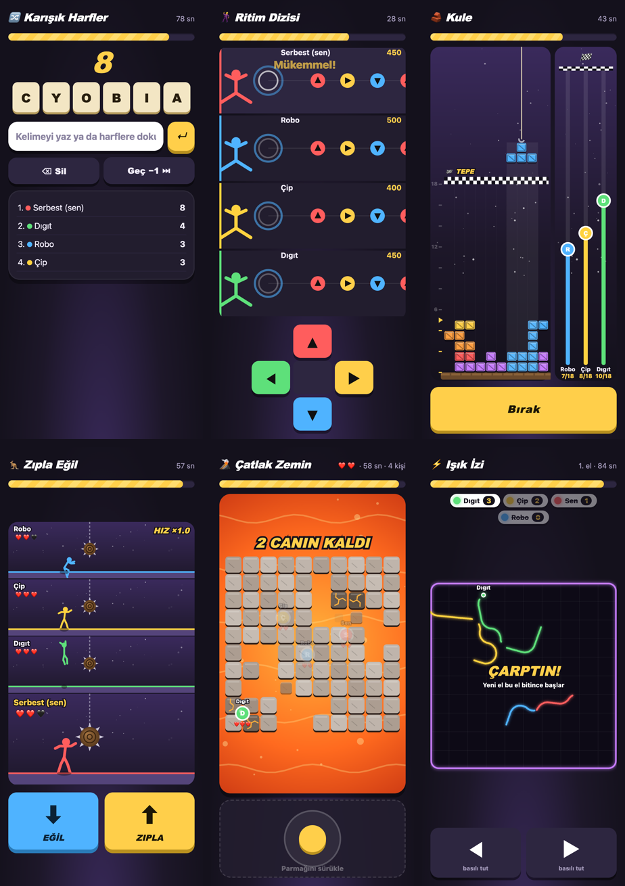
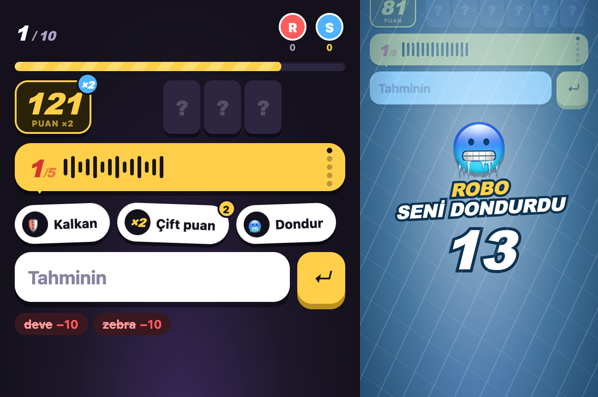

<p align="center">
  
</p>

<h1 align="center">Beş İpucu</h1>

<p align="center">
  <b>Five spoken clues. A melting score. Guess the word before your friends do.</b><br>
  A Turkish word-guessing party game for phones, with jokers and six fast mini-games in between. One person runs a small server; everyone else opens a link.
</p>

<p align="center">
  <b>English</b> · <a href="README.tr.md">Türkçe</a>
</p>

<p align="center">
  
</p>

---

> The game itself (words, clues, voice and interface) is in **Turkish**.

## How it plays

- Each round a secret word is described by **five clues read aloud**, hardest first, one every 6 seconds. The clue text is never shown, you have to listen.
- Your possible score **melts from 100 to 0** over the 30-second round. Every wrong guess costs 10 points, and the score counter shakes red.
- The round ends when everyone has guessed or time runs out. The host picks 10, 20, 50 or 100 words; words do not repeat while the server runs.
- **Jokers** are won in mini-games (1st place gets two, 2nd gets one): **Kalkan** (wrong guesses cost nothing), **Çift puan** (double points), **İlk harf** (first letter revealed) and **Dondur** (freeze a rival for 15 seconds; their screen ices over with your name on it).
- **Mini-games** appear at equal intervals in random order. The host ticks which ones may appear and can try any of them instantly with three bots:
  - **Karışık Harfler**: unscramble as many words as you can in 90 seconds.
  - **Ritim Dizisi**: hit the arrows as notes reach the ring, with dancers in every lane.
  - **Kule**: drop crates from a swinging crane and be the first to reach the top.
  - **Zıpla Eğil**: jump or duck the spiked rollers, three lives.
  - **Çatlak Zemin**: keep moving on cracking tiles over lava, three lives.
  - **Işık İzi**: light-trail arena, the last one not to crash scores.
- The game ends with an award ceremony and a small 3D hall where everyone can walk around and punch each other.

<p align="center">
  
</p>

## Run it

You need [Node.js](https://nodejs.org) 18 or newer, Python 3 and [ffmpeg](https://ffmpeg.org) (only once, to generate the clue audio).

```bash
git clone https://github.com/serbestonline/bes-ipucu.git
cd bes-ipucu
npm install
pip install edge-tts
python3 ses/uret.py      # generates the 2510 spoken clues once (about 60 MB, takes a while)
npm start
```

Open `http://localhost:3480` on the computer. Phones on the same Wi-Fi open `http://<computer's local IP>:3480`. The first player to join is the host.

### Play online with friends (free Cloudflare tunnel)

1. Install `cloudflared` (macOS: `brew install cloudflared`, Windows: `winget install --id Cloudflare.cloudflared`).
2. With the game running, start a quick tunnel; no Cloudflare account is needed:
   ```bash
   cloudflared tunnel --url http://localhost:3480
   ```
3. Send your friends the `https://….trycloudflare.com` link it prints.

### Settings

| Variable | Default | Meaning |
|---|---|---|
| `PORT` | `3480` | Server port |
| `HOST` | all interfaces | Address to listen on, e.g. `127.0.0.1` behind a reverse proxy |
| `TUR_MS` | `30000` | Round length in milliseconds |
| `YUKLEME_MS` | `15000` | Longest wait on the loading screen before the first round |

The game also works under a sub-path (for example behind nginx at `/oyun/`); WebSocket and asset URLs are relative.

## Tests

```bash
./testler.sh        # every test, each on a fresh server
./testler.sh bot    # all six mini-games played through by bots (a few minutes)
```

## Credits and license

Sounds are CC0 or synthesized for this project, the dictionary comes from Zemberek-NLP (Apache 2.0) and the 3D hall uses three.js (MIT). Details in [CREDITS.md](CREDITS.md). The code, words and clues are under the [MIT License](LICENSE).
