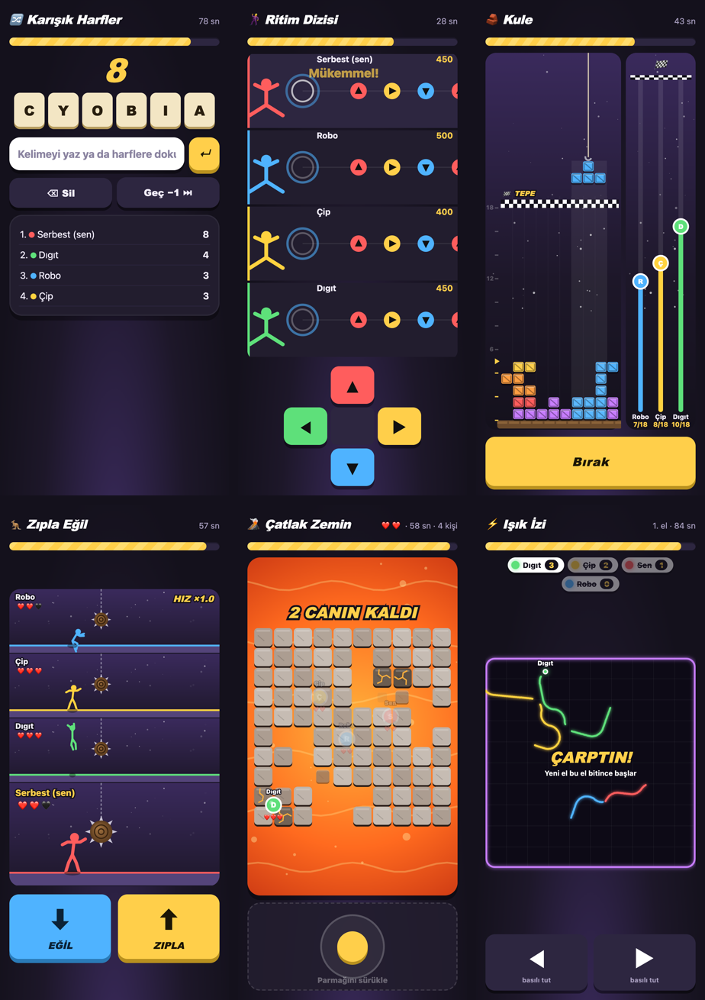
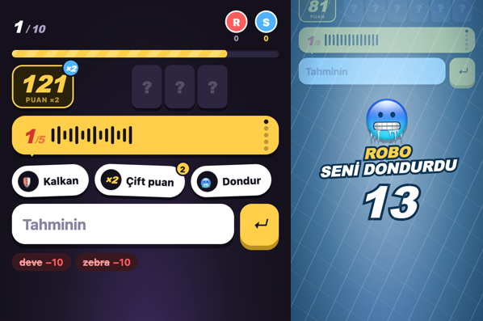

<p align="center">
  
</p>

<h1 align="center">Beş İpucu</h1>

<p align="center">
  <b>Beş sesli ipucu. Eriyen bir puan. Kelimeyi arkadaşlarından önce bil.</b><br>
  Telefondan oynanan Türkçe bir kelime tahmin parti oyunu; arada jokerler ve altı hızlı mini oyun var. Bir kişi küçük bir sunucu açar, diğerleri bağlantıyı açar.
</p>

<p align="center">
  <a href="README.md">English</a> · <b>Türkçe</b>
</p>

<p align="center">
  
</p>

---

## Nasıl oynanır

- Her turda gizli bir kelime, en zordan başlayarak altı saniyede bir **sesli okunan beş ipucuyla** anlatılır. İpucunun yazısı ekranda hiç görünmez, dinlemen gerekir.
- Alabileceğin puan otuz saniyelik turda **yüzden sıfıra erir**. Her yanlış tahmin 10 puan götürür, puan sayacı kırmızı sarsılır.
- Tur herkes bilince ya da süre dolunca biter. Kurucu 10, 20, 50 ya da 100 kelime seçer; sunucu açık kaldıkça kelimeler tekrar etmez.
- **Jokerler** mini oyunlarda kazanılır (birinciye iki, ikinciye bir): **Kalkan** (yanlış tahmin puan götürmez), **Çift puan**, **İlk harf** (cevabın ilk harfi görünür) ve **Dondur** (bir rakibi 15 saniye dondurur; ekranı senin adınla buz tutar).
- **Mini oyunlar** eşit aralıklarla, rastgele sırayla gelir. Kurucu hangilerinin çıkabileceğini tikler, istediğini üç botla hemen deneyebilir:
  - **Karışık Harfler**: 90 saniyede karışık harflerden olabildiğince çok kelime kur.
  - **Ritim Dizisi**: notalar halkaya gelince aynı yön tuşuna bas; her şeritte bir dansçı var.
  - **Kule**: sallanan vincten kasaları bırak, tepeye ilk ulaşan kazanır.
  - **Zıpla Eğil**: dikenli silindirlerin üstünden zıpla ya da altından eğil, üç can.
  - **Çatlak Zemin**: lavın üstünde çatlayan taşlarda durmadan yürü, üç can.
  - **Işık İzi**: ışık izi arenası, çarpmayan son kişi puan alır.
- Oyun bir ödül töreniyle ve herkesin dolaşıp birbirine yumruk atabildiği küçük bir 3D salonla biter.

<p align="center">
  
</p>

## Çalıştırma

[Node.js](https://nodejs.org) 18 ya da üstü, Python 3 ve [ffmpeg](https://ffmpeg.org) gerekir (son ikisi yalnız ipucu seslerini bir kez üretmek için).

```bash
git clone https://github.com/serbestonline/bes-ipucu.git
cd bes-ipucu
npm install
pip install edge-tts
python3 ses/uret.py      # 2510 sesli ipucunu bir kez üretir (yaklaşık 60 MB, biraz sürer)
npm start
```

Bilgisayarda `http://localhost:3480` adresini aç. Aynı Wi-Fi'daki telefonlar `http://<bilgisayarın yerel IP'si>:3480` adresini açar. Odaya ilk giren kurucu olur.

### Arkadaşlarla internetten oynamak (ücretsiz Cloudflare tüneli)

1. `cloudflared` kur (macOS: `brew install cloudflared`, Windows: `winget install --id Cloudflare.cloudflared`).
2. Oyun açıkken hızlı bir tünel başlat; Cloudflare hesabı gerekmez:
   ```bash
   cloudflared tunnel --url http://localhost:3480
   ```
3. Yazdığı `https://….trycloudflare.com` bağlantısını arkadaşlarına gönder.

### Ayarlar

| Değişken | Varsayılan | Anlamı |
|---|---|---|
| `PORT` | `3480` | Sunucunun portu |
| `HOST` | bütün arayüzler | Dinlenecek adres, örneğin bir ters vekil arkasında `127.0.0.1` |
| `TUR_MS` | `30000` | Turun süresi, milisaniye |
| `YUKLEME_MS` | `15000` | İlk turdan önce yükleme ekranında en fazla ne kadar beklenir |

Oyun bir alt yol altında da çalışır (örneğin nginx arkasında `/oyun/`); WebSocket ve dosya adresleri görelidir.

## Testler

```bash
./testler.sh        # bütün testler, her biri temiz bir sunucuda
./testler.sh bot    # altı mini oyunun botlarla baştan sona oynanması (birkaç dakika)
```

## Kaynaklar ve lisans

Sesler CC0 ya da bu proje için sentezlendi, sözlük Zemberek-NLP'den geliyor (Apache 2.0), 3D salon three.js kullanıyor (MIT). Ayrıntı [CREDITS.md](CREDITS.md) dosyasında. Kod, kelimeler ve ipuçları [MIT Lisansı](LICENSE) altındadır.
